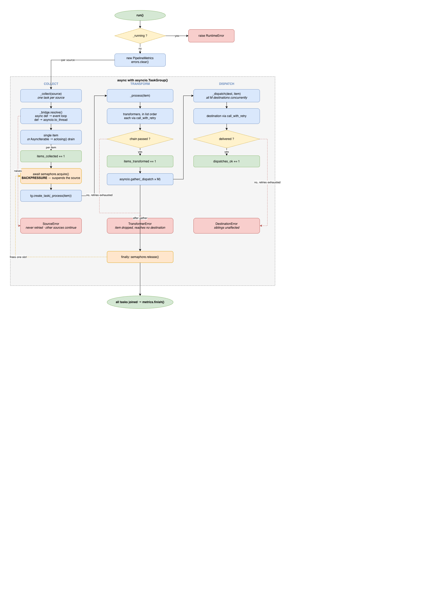

# AsyncDataPipeline

A pipeline collects items from several sources at once, applies a chain of
transformations to each item in order, and hands every result to all of its
destinations. A destination that fails does not stop the others.

The library has no runtime dependencies and exposes one class,
`AsyncDataPipeline`, with two entry points: the constructor and `run()`.

```python
import asyncio
from asyncdatapipeline import AsyncDataPipeline

async def numbers():
    for n in range(3):
        yield n

received = []
pipeline = AsyncDataPipeline(
    sources=[numbers],
    transformers=[lambda n: n * 2],
    destinations=[received.append],
)
asyncio.run(pipeline.run())
print(sorted(received))  # [0, 2, 4]
```

## Installation

Python 3.12 or later.

```bash
    pip install dist/asyncdatapipeline-0.1.0-py3-none-any.whl
```

For development:

```bash
    uv sync
```

## Usage

A pipeline is built from plain callables. There is nothing to subclass.

| Stage | Signature | Contract |
| --- | --- | --- |
| Source | `() -> T \| AsyncIterable[T] \| Awaitable[...]` | Called once per run. Returns one item, or an async iterable that gets drained. |
| Transformer | `(T) -> T \| Awaitable[T]` | One item in, one item out. Applied in list order. |
| Destination | `(T) -> None \| Awaitable[None]` | Receives every transformed item. |

Any of them can be `def` or `async def`. The aliases `Source`, `Transformer`
and `Destination` are exported so you can annotate your own callables.

Here is a pipeline reading from a file, an HTTP endpoint and a TCP socket,
then writing to a file and posting to an API. Standard library only.

```python
import asyncio, json, urllib.request
from asyncdatapipeline import AsyncDataPipeline

async def read_lines():
    with open("events.jsonl") as f:
        while line := await asyncio.to_thread(f.readline):
            yield json.loads(line)

def fetch_page():
    """Blocking call. Runs in a worker thread and returns one item."""
    with urllib.request.urlopen("https://api.example.com/events") as resp:
        return json.load(resp)

async def read_socket():
    reader, writer = await asyncio.open_connection("collector.internal", 9000)
    try:
        async for line in reader:
            yield json.loads(line)
    finally:
        writer.close()
        await writer.wait_closed()

def normalise(event: dict) -> dict:
    return {**event, "user": event["user"].strip().lower()}

def append_to_file(event: dict) -> None:
    with open("processed.jsonl", "a") as f:
        f.write(json.dumps(event) + "\n")

async def main() -> None:
    pipeline = AsyncDataPipeline(
        sources=[read_lines, fetch_page, read_socket],
        transformers=[normalise],
        destinations=[append_to_file],
        max_concurrent_tasks=50,
    )
    await pipeline.run()

    m = pipeline.metrics
    print(f"{m.items_collected} collected, {m.dispatches_ok} dispatched "
          f"in {m.duration:.2f}s")
    for error in pipeline.errors:
        print(error, "<-", repr(error.__cause__))

asyncio.run(main())
```

Note that `fetch_page` returns a list, and that list is one item. To turn the
same call into a stream, wrap it in an async generator and yield each record.

The constructor takes callables, not configuration. Bind parameters with
`functools.partial` or a closure:

```python
post = functools.partial(post_to, url=os.environ["SINK_URL"], timeout=10)
```

## Execution model



These rules apply to sources, transformers and destinations alike.

A callable declared `async def` runs inline on the event loop. A callable
declared `def` runs in a worker thread. There is no switch for this: you pick
inline or threaded execution by how you declare the callable. Cheap work
belongs in `async def` and pays no thread hop; blocking work belongs in `def`
and cannot stall the loop.

Each source is called exactly once per run. One that returns a value or an
awaitable contributes a single item. One that returns an async iterable is
drained until exhausted. No polling, no sentinel values.

Only async iterables count as streams. A source returning a list contributes
that list as one item.

At most `max_concurrent_tasks` items are in flight at any moment, counting
from the instant a source produces an item to the instant the last
destination is done with it. When the limit is reached, the source that tries
to produce the next item is suspended. Backpressure therefore reaches the
producer instead of items piling up in a queue.

## Errors and retries

`run()` does not raise because a source, transformer or destination failed. It
raises `RuntimeError` if a run is already in progress, and propagates
`asyncio.CancelledError` if the run itself is cancelled. Everything else is
recorded and the run continues.

Sources are never retried. Re-invoking a source that failed halfway through a
stream would re-emit the items it had already produced. Items produced before
the failure keep flowing and the failure is recorded as a `SourceError`.

Transformers and destinations are retried three times with exponential
backoff: 0.1s after the first failure, doubling, capped at 5s, with jitter
across the upper half of each window so concurrent retries do not fire in
lockstep. `asyncio.CancelledError` is never retried.

A transformer that exhausts its retries drops the item, which then reaches no
destination (`TransformerError`). A destination that exhausts its retries
loses the item for itself only, and its siblings are unaffected
(`DestinationError`).

After a run, `pipeline.errors` holds up to 100 `StageError` instances from
that run. Each one carries the stage, the callable's name, the attempt count
and a bounded `repr` of the item; the original exception is on `__cause__`.
Raw items are deliberately not retained, so a run that fails on every item
cannot pin its payloads in memory. Failures past the cap are still counted in
`metrics.failures` and logged.

## Metrics

`pipeline.metrics` is a fresh `PipelineMetrics` for every run. Reading it
while a run is in progress is safe, since all updates happen on the event loop
thread.

| Field | Meaning |
| --- | --- |
| `items_collected` | Items produced by all sources |
| `items_transformed` | Items that cleared the whole transformer chain |
| `dispatches_ok` | Successful destination calls (1 item x 3 destinations = 3) |
| `failures` | Count per stage, plus `failures_total` |
| `duration` | Seconds since start; live while running, frozen once finished |
| `throughput` | `items_transformed / duration` |
| `mean_latency` | Average per-item time from first transformer to last destination |

## Logging

Everything goes to the `asyncdatapipeline` logger. The library installs no
handler, so configure `logging` as you normally would.

| Level | Event |
| --- | --- |
| INFO | Run started (with its configuration), run finished (with counters) |
| WARNING | An attempt failed and will be retried |
| ERROR | A stage failed for good, with the traceback of the cause |
| DEBUG | How many items each source contributed |

## Limitations

Each of the following is a trade-off the design accepts.

An object that is both awaitable and async-iterable is ambiguous. The pipeline
checks `AsyncIterable` first and treats it as a stream. Await it yourself
inside the source if you need the other behaviour. For the same reason, an
item that is itself an async iterable cannot be passed through as a single
item; wrap it in a generator that yields it.

The type parameter describes the item type, not the interior of the chain.
`AsyncDataPipeline[dict]` means sources produce `dict`, every transformer maps
`dict` to `dict`, and destinations accept `dict`. A chain that changes type
along the way runs correctly but is not checked statically, because a
homogeneous list cannot express a heterogeneous sequence of mappings. Compose
and annotate such a chain yourself, then pass it as one transformer.

Transformers cannot filter or fan out. A transformer that raises is a failure,
not a filter. Filter inside the source, and split one item into many by
yielding them from the source.

Synchronous callables run in the loop's default executor rather than on a
single thread, so they must be thread-safe. Shared mutable state is the
caller's responsibility. A synchronous callable already in flight cannot be
cancelled: the awaiting task raises `CancelledError` at once, but the callable
itself runs to completion in its worker thread.

`max_concurrent_tasks` does not bound the thread pool. The default executor
holds `min(32, cpu_count + 4)` threads, so setting the limit above that number
means synchronous callables queue behind the executor instead of behind the
pipeline. Installing a private executor would mean owning a resource lifecycle
the library otherwise has none of.

Delivery is at-least-once per destination within a run. A destination that
raised after a partial side effect gets retried and may see the same item
twice, so make destinations idempotent. There is no checkpointing: items in
flight when a run is cancelled are lost, and a new run starts every source
from scratch.

The retry policy is fixed, since the prescribed constructor signature has no
slot for it. `RetryPolicy` and `call_with_retry` are exported for callables
that need different behaviour.

Destinations share the item object rather than a copy, so a destination that
mutates its argument affects its siblings. `None` is a valid item and is not
skipped.

## Tests

```bash
    uv sync
    uv run pytest
```

79 tests across the five modules, under a second. The pipeline tests patch the
retry policy to zero delay. Static checks:

```bash
    uv run ruff check .
    uv run mypy asyncdatapipeline
````

## Building

```bash
    uv build
```

writes the wheel and sdist to `dist/`. The wheel is pure Python. The build
backend is declared per PEP 518 and project metadata per PEP 621.

## Optional features

| Nice-to-have | Status |
| --- | --- |
| Configurable concurrency | Implemented. `max_concurrent_tasks`, with backpressure to the producer. |
| Monitoring metrics | Implemented. Throughput, mean latency, per-stage failures, duration, readable live. |
| Reprocessing and recovery | Not implemented. The library owns no storage, and a durable offset belongs in the source, the only stage that knows what "resume" means for its medium. |
| Secure transmission | Delegated to the callables, which own the transport. Pass `https://` URLs, `asyncio.open_connection(..., ssl=...)` or your client's TLS options. See the note below on log contents. |
| Configuration via env or files | Left to the caller. Bind parameters with `functools.partial` as shown above. |
| Horizontal scalability | Single process. Nothing is process-global, so you can run one pipeline per process over a partition of the sources. |
| Multipart processing | Not implemented. |

## Time spent

Approximately 9 hours (8 h 43 measured, and a third of which was spent reviewing and improving the documentation and tests).
